<div align="center">

# Reel

**A movie and TV companion for iOS and Android that feels like it shipped with the phone.**

Discover what to watch, dig into every title, person and collection on TMDB, and keep your watchlist, ratings and lists in sync with your TMDB account. In English and Arabic, in light and dark.


<br/>

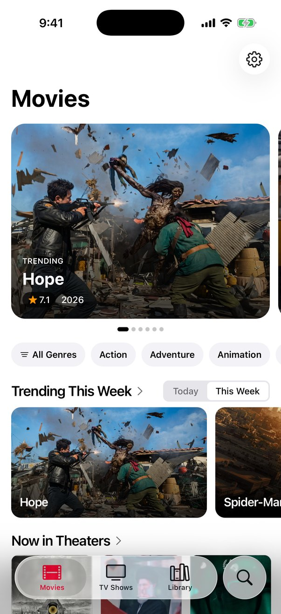
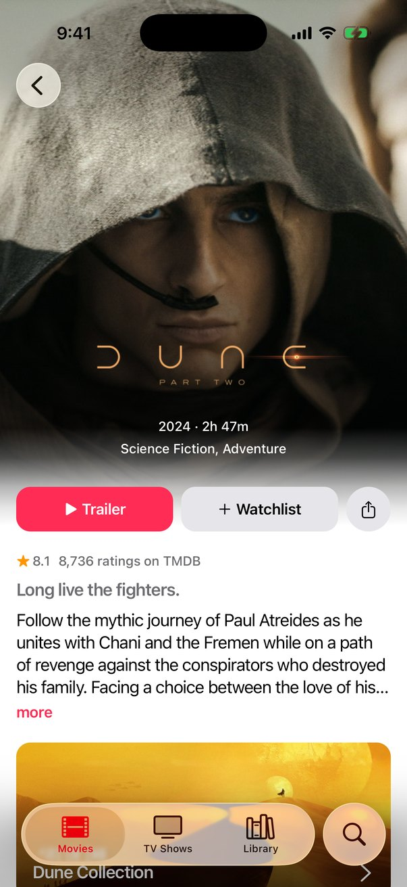
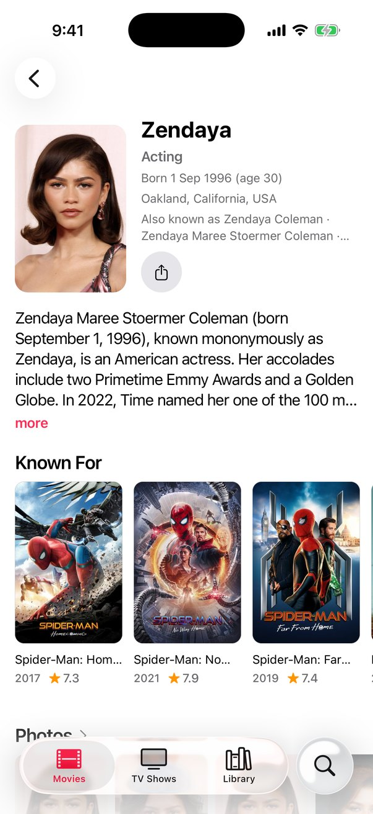
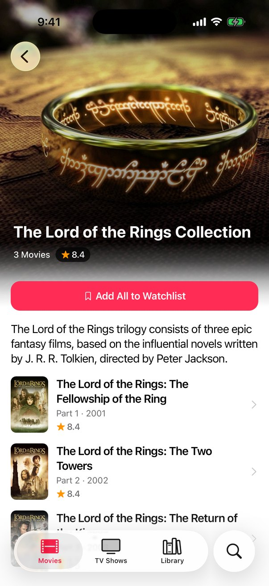

</div>

---

## Why Reel

Most TMDB clients look like websites in a wrapper. Reel uses the platform's own parts wherever it can: native tabs (Liquid Glass on iOS 26, Material navigation on Android), native stacks with large titles, the system search field, SF Symbols and Material Symbols, system sheets, alerts and the share sheet. Everything else is a small set of themed components, so the whole app reads as one piece.

## Features

### Discover
- **Movies and TV home**: a featured carousel, trending today or this week, now playing, upcoming, popular and top rated movies; airing today, on the air, popular and top rated shows; and a genre strip
- **Browse with real filters**: sort by popularity, rating, release date, votes or box office; genres; the streaming services in your region; decade; minimum rating; runtime; original language
- **Browse from anywhere**: tap a genre, keyword, studio or network to see everything that shares it

<p align="center">
  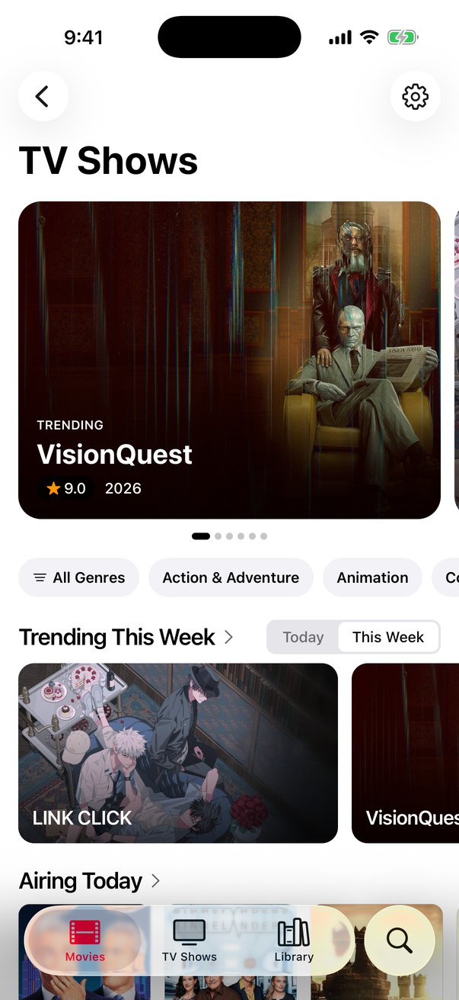
  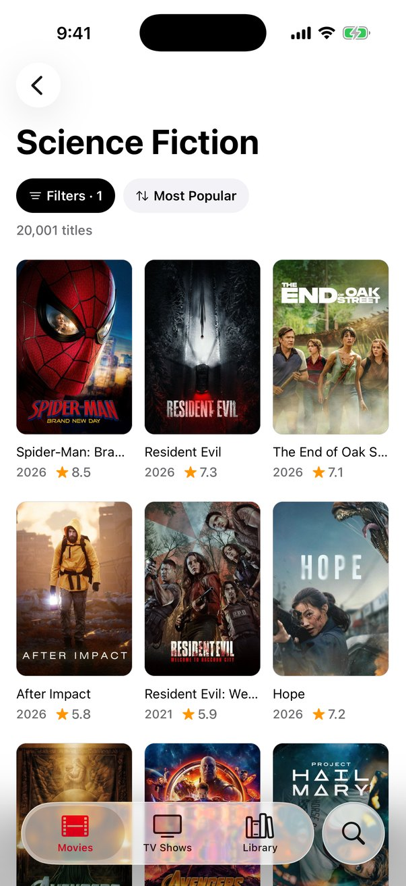
  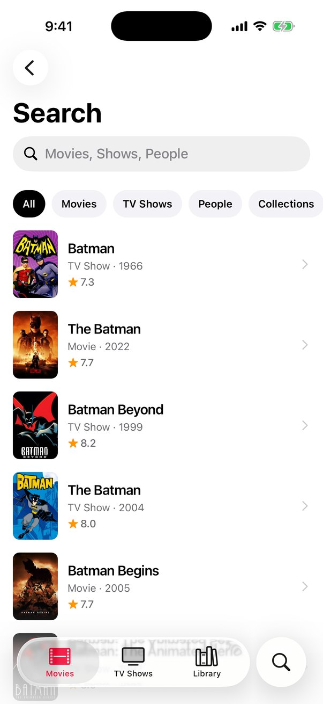
  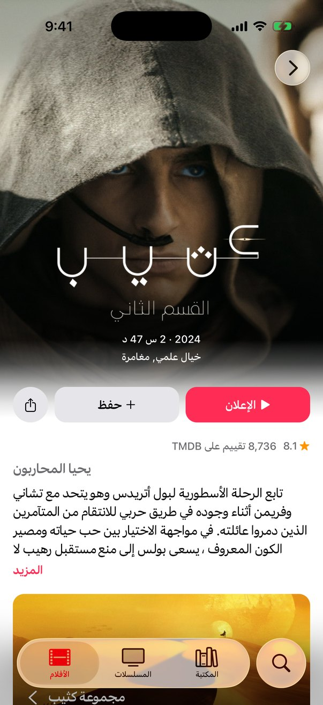
</p>

### Every detail TMDB has
- **Title pages** with the title's logo over its artwork, where to watch (stream, rent, buy), trailers and videos, cast and crew, seasons and episodes, backdrops and posters, reviews, recommendations, keywords, studios and networks, release dates in your region, and links to IMDb, Instagram, X and the official site
- **Seasons and episodes** with stills, ratings, directors, writers and guest stars
- **Collections** with every part in order, and one button to add the whole series to your watchlist
- **People** with biography, photos, known-for, and credits filtered by department and by movie or TV
- **Photo gallery**: full-screen, swipeable, pinch to zoom, share any image
- **Search** across titles, people, collections, studios and keywords

### Your library
- **Watchlist** that works with no account and moves to your TMDB account when you sign in
- **TMDB sign-in** through TMDB's own approval page; the session lives in the Keychain or Keystore
- **Favorites, ratings and lists**: heart a title, rate it out of 10, build public lists, and get recommendations from your taste
- **Bulk actions**: long-press or tap Select, pick as many titles as you like, then add them to your watchlist or any list, or remove them in one go

<p align="center">
  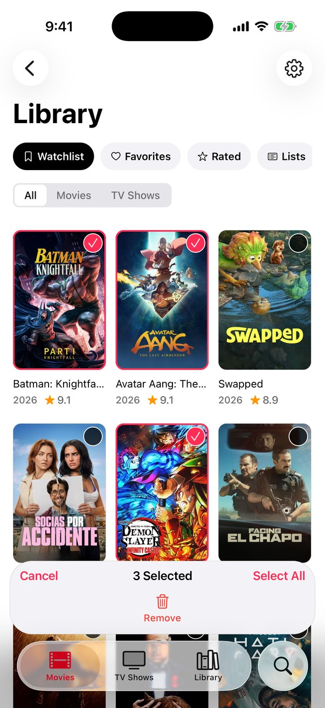
  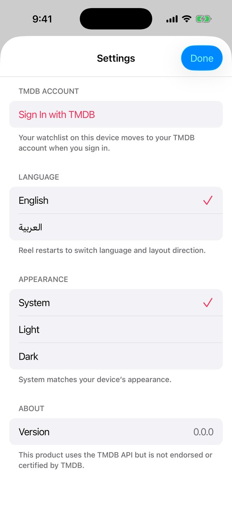
  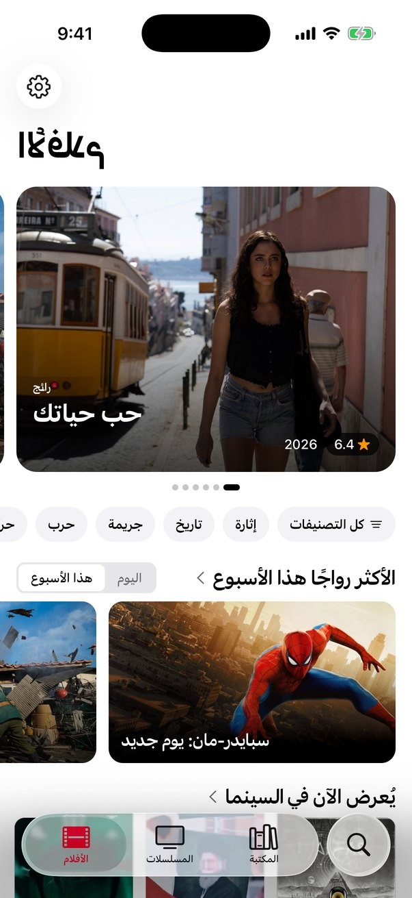
  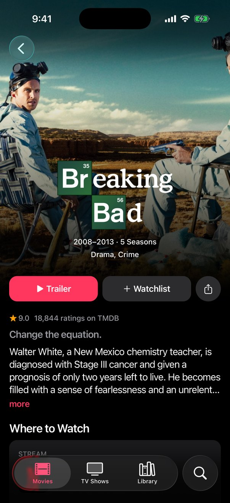
</p>

### Made for everyone
- **English and Arabic**, with a full right-to-left layout, Arabic month names and TMDB's Arabic titles, overviews and logos
- **Light, dark or system** appearance
- **Haptics** on every toggle and save, and VoiceOver and TalkBack labels throughout

## Getting started

You need Node 20+, Xcode 26 for iOS or Android Studio for Android, and a free TMDB account.

```bash
git clone https://github.com/ismail-ahm3d/reel.git
cd reel
npm install
cp .env.example .env.local   # then paste your TMDB token into it
npm run ios                  # or: npm run android
```

Get the token from [TMDB → Settings → API](https://www.themoviedb.org/settings/api): copy the **API Read Access Token** (v4), not the short API key.

Reel uses Unistyles 3, which needs native code, so it runs as a development build rather than in Expo Go. After the first `npm run ios` or `npm run android`, `npm start` is enough to serve the JavaScript.

### Scripts

| Command | What it does |
|---|---|
| `npm run ios` / `npm run android` | Builds and launches the development build |
| `npm start` | Serves JavaScript to an installed development build |
| `npm run check` | Everything CI checks: type check, lint, architecture rules, unit tests |
| `npm test` | Unit tests only |

## How it is built

| Concern | Choice |
|---|---|
| App framework | Expo SDK 57, React Native 0.86, React 19, TypeScript in strict mode |
| Navigation | Expo Router with native tabs and a native stack per tab |
| Styling | Unistyles 3 with theme tokens for color, type, spacing and shape |
| Server state | TanStack Query over plain use cases |
| Validation | Zod schemas for every TMDB response |
| Images and icons | expo-image, SF Symbols and Material Symbols through expo-symbols |
| Storage | expo-sqlite key-value store for settings and the offline watchlist; expo-secure-store for the TMDB session |

The code is split by feature, and each feature by layer:

```
app/                        Routes only: read params, pick dependencies, render a screen
src/
  shell/                    The app itself: composition root, theme, boot, navigation
  shared/                   What several features use: session, watchlist, TMDB DTOs, App* components, i18n
  features/
    discover/ search/ title/ people/ gallery/ account/ settings/
      domain/               Models, repository interfaces, use cases (no React, no Expo)
      data/                 TMDB data sources, DTOs, mappers, repository implementations
      presentation/         Screens, their hooks, components, query keys
```

Domain code never imports React or Expo, presentation never imports data, and features never import each other. [dependency-cruiser](https://github.com/sverweij/dependency-cruiser) enforces these rules on every `npm run check`. Design decisions are recorded in [`docs/decisions`](docs/decisions).

## A note on the token

`EXPO_PUBLIC_*` variables are bundled into the app. TMDB's read access token is read-only, but anyone who unpacks a build can read it. Put a small proxy in front of TMDB before publishing Reel to a store.

## Credits

Movie and TV data, images and logos come from [The Movie Database (TMDB)](https://www.themoviedb.org).


This product uses the TMDB API but is not endorsed or certified by TMDB.
